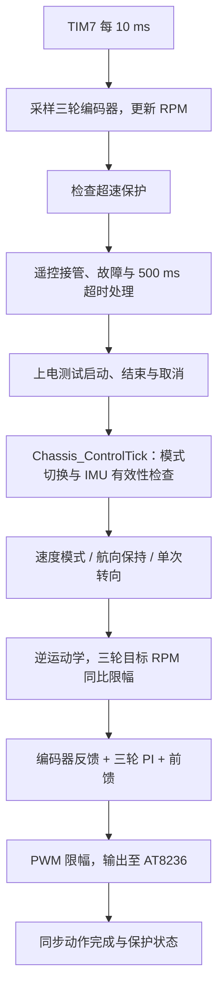

# 控制与调试说明

## 控制流程

启动时依次初始化 HAL、时钟和外设，再通过 `Chassis_Init()` 启动编码器/PWM，装载控制参数，初始化 IMU、遥控与上电测试，最后启用 TIM7。

主循环负责遥控文本解析、接收恢复和每 100 ms 一次的 USART3 DMA 日志；运动参数更新与电机控制由 TIM7 调度。



STOP 输出零 PWM 并滑行；保护锁存时保持主动刹车并取消旧运动命令。航向相关模式要求最近 500 ms 内有有效 IMU 角度帧，失效后停止，恢复数据后需重新下发模式。IMU 接收异常时会清除残帧并立即使旧角度失效，异步恢复 DMA 后等待完整有效角度帧。普通速度遥控不依赖 IMU。

## 基本控制入口

`Core/Inc/main.h` 声明控制模式和目标参数；`Core/Src/main.c` 的 `Chassis_ControlTick()` 每 10 ms 执行一次。

先保持 `g_control_mode = CHASSIS_CONTROL_STOP`，写好目标参数，再选择运动模式。调试器修改参数时暂停 MCU；代码中同时更新多个命令字段时使用短临界区，避免中断读取到不完整命令。

| 模式 | 数值 | 使用参数 | 行为 |
| --- | --- | --- | --- |
| `CHASSIS_CONTROL_STOP` | 0 | 无 | 停止，清除控制历史 |
| `CHASSIS_CONTROL_VELOCITY` | 1 | `g_target_vx`、`g_target_vy`、`g_target_omega` | 三轮速度闭环，无航向保持 |
| `CHASSIS_CONTROL_STRAIGHT` | 2 | `g_target_vx` | 直行，锁定进入模式时的航向 |
| `CHASSIS_CONTROL_LATERAL` | 3 | `g_target_vy` | 横移，锁定进入模式时的航向 |
| `CHASSIS_CONTROL_COMBINED` | 4 | `g_target_vx`、`g_target_vy` | 前后与横向组合运动，保持航向 |
| `CHASSIS_CONTROL_TURN` | 5 | `g_turn_angle_deg` | 单次相对转向，完成或失败后自动停止 |

`vx/vy` 单位为 m/s，正方向分别为前方、左侧；`omega` 单位为 rad/s，正方向为逆时针。转角单位为度，正值逆时针，自动取 ±180° 内最短路径。进入转向模式时锁存转角；再次转向需先回到停止模式，再进入转向模式。

例如，在停止状态下写 `g_target_vx = 0.15f`，再写 `g_control_mode = CHASSIS_CONTROL_STRAIGHT`，即可按当前航向直行；写回 `CHASSIS_CONTROL_STOP` 停止。写 `g_turn_angle_deg = 90.0f` 后选择 `CHASSIS_CONTROL_TURN`，执行单次 90° 转向。

`RPM_A/B/C` 保存实测轮速。`g_turn_state` 保存转向状态，数值对应 `Omni_TurnState_t`：0 空闲、1 转向中、2 完成、3 超时、4 越限。直行、横移、组合运动和转向要求 500 ms 内有有效 IMU 角度帧；失效时取消命令并停机。超速或失控保护触发后保持刹车锁定，清除保护不会恢复旧运动命令。

## 上电单次动作测试

参数集中在 `Core/Src/main.c` 的 `USER CODE BEGIN PD` 区，均有中文注释。修改宏后重新编译、烧录；也可用编译器 `-D` 覆盖。默认配置如下：

| 参数 | 默认值 | 用途 |
| --- | --- | --- |
| `POWER_ON_TEST_ENABLE` | `0U` | `0` 关闭，`1` 上电执行一次 |
| `POWER_ON_TEST_MODE` | `CHASSIS_CONTROL_STRAIGHT` | `2` 直行、`3` 平移、`5` 180° 转向 |
| `POWER_ON_TEST_STRAIGHT_SPEED_MPS` | `0.15f` | 直行速度 m/s，正值前进、负值后退 |
| `POWER_ON_TEST_LATERAL_SPEED_MPS` | `0.15f` | 平移速度 m/s，正值向左、负值向右 |
| `POWER_ON_TEST_STRAIGHT_DURATION_MS` | `2000U` | 直行测试时长 ms |
| `POWER_ON_TEST_LATERAL_DURATION_MS` | `2000U` | 平移测试时长 ms |
| `POWER_ON_TEST_START_DELAY_MS` | `2000U` | 初始化完成后等待多久再允许启动 |
| `POWER_ON_TEST_IMU_WAIT_TIMEOUT_MS` | `5000U` | 启动延迟结束后等待有效 IMU 的最长时间 |

例如，前进 3 秒：设置 `POWER_ON_TEST_ENABLE=1U`、`POWER_ON_TEST_MODE=CHASSIS_CONTROL_STRAIGHT`、`POWER_ON_TEST_STRAIGHT_DURATION_MS=3000U`；向左平移 2 秒：模式改为 `CHASSIS_CONTROL_LATERAL`，设置平移速度与时长；180° 掉头：模式改为 `CHASSIS_CONTROL_TURN`。

启动过程非阻塞，由 TIM7 每 10 ms 调度：先保持停止，等待启动延迟结束和有效 IMU，再执行所选动作。直行/平移从首次驱动周期开始计时，到时切换 STOP、输出零 PWM；时长按控制周期处理，最多有一个 10 ms 周期的量化误差。转向固定为相对 180°，不使用直行/平移时长，沿用 3° 到位容差、连续 20 周期（200 ms）确认和 8 秒运动超时。180° 两侧最短路径等价，掉头方向不固定。

日志 `ptest` 对应 `g_power_on_test_state`：`0` 关闭、`1` 等待、`2` 运行、`3` 完成、`4` 取消。IMU 等待超时、运行中 IMU 失效、保护触发或对应行驶使能关闭都会取消测试并停车；无效动作、直行/平移的零时长、零速度及非有限速度也不会启动。手动切换模式会退出自动测试，新手动命令继续由基础控制处理；运行中设 STOP 即停车。等待阶段本来就是 STOP，重复写 STOP 不会取消等待。

完成或取消后本次上电不再自动执行，复位可重新测试；保护锁存时还需要先排除故障并清除保护或复位。关闭上电测试后，手动直行/平移仍需主动设置 STOP 结束。

## 串口速度遥控

USART1 为遥控接收串口：PA10 接遥控端 TX，PA9 为 MCU TX，共地，115200、8 数据位、无校验、1 停止位。USART2 继续接 IMU，USART3 继续输出日志；USART1 当前不发送指令回执。

发送 ASCII 文本 `x,y,w`，每帧以换行 LF 结束，也接受 CRLF。`x` 是前后速度、`y` 是横移速度，单位 m/s；`w` 是角速度，单位 rad/s。正值分别表示向前、向左、逆时针。允许空格、十进制和科学计数法；帧必须恰好有三个字段。

| 发送内容（末尾加换行） | 动作 |
| --- | --- |
| `0.15,0,0` | 前进 0.15 m/s |
| `-0.15,0,0` | 后退 0.15 m/s |
| `0,0.15,0` | 向左平移 0.15 m/s |
| `0,-0.15,0` | 向右平移 0.15 m/s |
| `0,0,0.5` | 逆时针自转，0.5 rad/s |
| `0.15,0.1,0.2` | 同时前进、左移和旋转 |
| `0,0,0` | 停车 |

串口助手应开启发送末尾换行，并建议每 10 ms（100 Hz）循环发送当前速度。遥控指令最多保持 500 ms，没有完整有效的新帧就自动切 STOP；10 ms 控制周期会带来至多一个周期的响应量化误差。发送字符串中的 `\n` 表示实际换行字节，不是两个可见字符。每次发送只更新速度，不会重复启动单次转向。

所有非零遥控帧直接使用三轮速度闭环，不锁定航向，也不依赖 IMU 有效；若要保持航向，可使用原有手动直行/平移/组合模式。有效遥控帧（包括 `0,0,0`）会取消本次上电测试；停止或断线后，上电测试不会重新启动。没有有效遥控帧时，原有上电测试和手动控制照常工作。

可在 `Core/APP/Remote/remote_control.h` 配置 `REMOTE_CONTROL_TIMEOUT_MS`（默认 500ms）、`REMOTE_CONTROL_MAX_LINEAR_SPEED_MPS`（默认 x/y 各 ±0.5m/s）和 `REMOTE_CONTROL_MAX_OMEGA_RAD_S`（默认 w ±2rad/s）。超范围、NaN/Inf、十六进制、缺字段或多余字段整帧拒绝，不刷新超时时间；此前遥控运动最多保持到原有超时截止。超长行、队列溢出、UART/DMA 接收异常则使旧指令失效，遥控已接管时停车，恢复接收后丢弃到下一换行边界，再等待后续完整有效帧。

遥控不能解除超速/失控保护。保护进入、解除及超时停车时会失效旧队列、半帧和 DMA 残留；主循环恢复接收后，先丢弃至下一个 LF 边界，再接受完整新速度帧。恢复通信时可先单独发送一个 LF，再发送速度帧；持续以 100 Hz 发送时，首帧可能仅用于同步，后续完整帧即可接管。已到期的遥控看门狗先执行停车，不用截止时才补齐的帧延续旧动作。USART3 日志 `rc=1` 表示遥控正在控制持续运动，`rto=1` 表示遥控超时/过期帧/接收故障；`trip` 仍显示电机保护状态。

## 速度环

遥控非零速度帧进入 `CHASSIS_CONTROL_VELOCITY`，TIM7 每 10 ms 采样编码器并运行三轮速度环。速度误差为 `e = 目标 RPM - 编码器 RPM × dir`，增量式 PID 的单次修正为 `Δu = Kp × (e - e_prev) + Ki × e + Kd × (e - 2 × e_prev + e_prev2)`，再累加到 `speed_output`。当前三轮 `Kd=0`，实际启用的是 PI；微分项未启用。

| 参数 | A 后轮 | B 右前轮 | C 左前轮 |
| --- | --- | --- | --- |
| Kp | 1.0 | 1.0 | 1.0 |
| Ki（每个 10 ms 周期） | 0.08 | 0.09 | 0.09 |
| Kd | 0 | 0 | 0 |
| 前馈增益（PWM/RPM） | 6.8 | 9.2 | 9.0 |

单周期 `Δu` 限幅 ±40，累计 `speed_output` 限幅 ±2000。最终控制量为 `ctr_input = -(目标 RPM × 对应轮前馈增益 + speed_output)`，限幅到 PWM 定时器 ARR（当前 ±2099）并转换为整数，再交给双 PWM 驱动。整体负号适配已有电机方向标定；实际车轮转向仍需接电机确认。明确停车和保护刹车会清除速度环历史；目标换向或某一路目标归零时清除该轮历史，避免旧修正量带入新动作。

## 硬件映射

| 部件 | 外设 / 引脚 |
| --- | --- |
| A 后轮 PWM | TIM1 CH1/CH2，PE9/PE11 |
| B 右前轮 PWM | TIM2 CH3/CH4，PB10/PB11 |
| C 左前轮 PWM | TIM3 CH1/CH2，PA6/PA7 |
| A/B/C 编码器 | TIM4 / TIM5 / TIM8 |
| IMU | USART2，PA2/PA3，115200 |
| 遥控接收 | USART1，PA9/PA10，115200 |
| 调试日志 | USART3，PD8/PD9，115200，每 100 ms |

机械方向、前馈增益及速度环参数需根据硬件标定；离散 Ki/Kd 和单周期增量限幅必须与控制周期一致。


## 参数位置

- 控制周期：`Core/Inc/control_timing.h`。
- 三轮速度环与航向环：`Core/Inc/chassis_config.h`，初始化与再次转向共用配置。
- 机械尺寸、反馈方向、前馈与轮速/转向限幅：`Core/APP/Omni/Omni.h`。
- 编码器每圈脉冲数：`Core/APP/Encoder/encoder.h`。
- 超速阈值与确认窗口：`Core/APP/Safety/motor_safety.h`。
- 遥控速度范围与超时：`Core/APP/Remote/remote_control.h`。
- 上电单次动作：`Core/Src/main.c` 的 `USER CODE BEGIN PD` 区。

调参和改变控制周期后，在真实电机与编码器上验证闭环。原有离散 Ki/Kd 与单周期限幅不能直接用于任意新周期。本仓库不包含主机测试。

## 构建选项

根目录 `stm32_omni_chassis.ioc` 可用 STM32CubeMX 打开，修改外设配置后需检查生成代码的 `USER CODE` 保留区。

如果不使用 Ninja，可在提供 Make 的环境下显式选择生成器：

```sh
cmake -S . -B build/LocalDebug -G "Unix Makefiles" \
  -DCMAKE_TOOLCHAIN_FILE=cmake/gcc-arm-none-eabi.cmake \
  -DCMAKE_BUILD_TYPE=Debug
cmake --build build/LocalDebug --parallel
```

优化构建使用 `cmake --preset Release` 和 `cmake --build --preset Release --parallel`。更换工具链、主机或源码目录后使用新构建目录，避免复用带旧绝对路径的 CMake 缓存。构建目录已由根目录 `.gitignore` 排除。